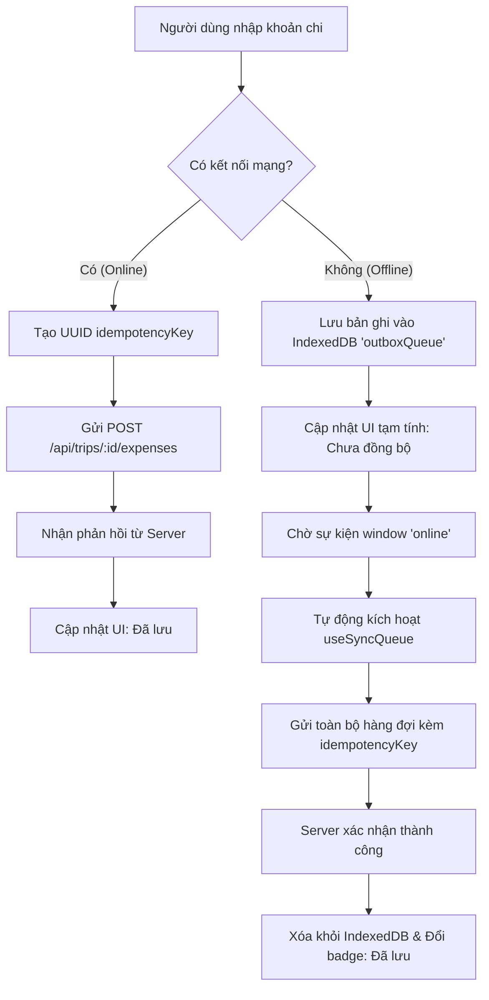

# HaGiangWiki — Thiết kế Cấu trúc Frontend & Backend

> **Tài liệu đặc tả kiến trúc kỹ thuật chi tiết phục vụ triển khai Tuần 1.**  
> **Phiên bản:** 1.0 — Ngày 09/11/2026.  
> **Bám sát mục tiêu:** Ứng dụng di động dùng chung cho 2 người, hoạt động khi mất mạng, bảo vệ toàn vẹn dữ liệu và tính toán công nợ chuẩn xác.

---

## 1. Tổng quan kiến trúc & Nguyên tắc cốt lõi

Dự án sử dụng mô hình **Monorepo tinh gọn** đặt trong thư mục gốc `HaGiangWiki`:

```text
HaGiangWiki/
├── backend/          # RESTful API Service (Node.js + Express + TypeScript + Prisma)
├── frontend/         # Mobile-first Web App / PWA (React + Vite + Tailwind CSS)
├── docs/             # Tài liệu thiết kế & quy trình dự án
└── package.json      # Quản lý script khởi chạy & cài đặt chung
```

### 3 Nguyên tắc kỹ thuật bắt buộc:
1. **Nguồn chân lý duy nhất (Single Source of Truth):** Backend và Database chịu trách nhiệm kiểm tra quyền, tính toán tiền tệ và kiểm tra xung đột version. Frontend không tự quyết định số dư công nợ cuối cùng.
2. **An toàn dữ liệu khi mạng chập chờn (Network Resiliency):** Mọi API ghi dữ liệu quan trọng (chi tiêu, điểm dừng) đều yêu cầu `Idempotency-Key` do client sinh ra để chống gửi trùng khi mất mạng/retry.
3. **Optimistic Locking (Kiểm soát đồng thời):** Mọi bản ghi chỉnh sửa lịch trình đều kèm theo trường `version` để phát hiện và ngăn chặn việc 2 người ghi đè dữ liệu âm thầm lên nhau.

---

## 2. Chi tiết cấu trúc Backend

* **Công nghệ chủ đạo:** Node.js, Express, TypeScript, Prisma ORM, PostgreSQL.
* **Kiến trúc mã nguồn:** Layered Architecture chia theo Module chức năng (Modular Structure).

> Quy ước tên thư mục: dự án sử dụng thống nhất `backend/` và `frontend/`. Không dùng đồng thời các tên `server/` và `client/`.

### 2.1. Cây thư mục Backend

```text
backend/
├── prisma/
│   ├── schema.prisma                  # Định nghĩa Model, Index, Foreign Keys
│   ├── seed.ts                        # Dữ liệu mẫu (Cột cờ Lũng Cú, Mã Pí Lèng, Đồng Văn...)
│   └── migrations/                    # Lịch sử migration database
├── src/
│   ├── config/                        # Cấu hình hệ thống
│   │   ├── env.ts                     # Validate biến môi trường (PORT, DATABASE_URL, JWT_SECRET)
│   │   └── database.ts                # Khởi tạo Prisma Client singleton
│   ├── middlewares/                   # Bộ lọc trung gian
│   │   ├── auth.middleware.ts         # Kiểm tra token định danh người dùng
│   │   ├── tripAccess.middleware.ts   # Xác minh quyền truy cập theo tripId (chỉ A hoặc B)
│   │   ├── idempotency.middleware.ts  # Bắt trùng lặp dựa trên header 'Idempotency-Key'
│   │   ├── validate.middleware.ts     # Validate request body (dùng Zod)
│   │   └── errorHandler.ts            # Bắt lỗi toàn cục, định dạng JSON lỗi chuẩn
│   ├── modules/                       # Các module nghiệp vụ chính
│   │   ├── auth/                      # Quản lý phiên làm việc & mã mời tham gia chuyến đi
│   │   │   ├── auth.controller.ts
│   │   │   ├── auth.service.ts
│   │   │   └── auth.routes.ts
│   │   ├── trip/                      # Cấu hình chuyến đi, đổi số ngày, thành viên
│   │   │   ├── trip.controller.ts
│   │   │   ├── trip.service.ts
│   │   │   └── trip.routes.ts
│   │   ├── stop/                      # Kho tạm (day=0), lịch trình ngày, đổi thứ tự
│   │   │   ├── stop.controller.ts
│   │   │   ├── stop.service.ts
│   │   │   └── stop.routes.ts
│   │   ├── expense/                   # Chi tiêu, chia tiền, công nợ, chuyển trả
│   │   │   ├── expense.controller.ts
│   │   │   ├── expense.service.ts     # Engine tính toán số dư công nợ A/B
│   │   │   └── expense.routes.ts
│   │   ├── external/                  # Proxy gọi dịch vụ ngoài (Thời tiết, Khoảng cách)
│   │   │   ├── weather.service.ts     # Gọi Open-Meteo API + In-memory Cache
│   │   │   ├── routing.service.ts     # Gọi OSRM Routing + In-memory Cache
│   │   │   └── external.routes.ts
│   │   └── sync/                      # Endpoint đồng bộ ngoại tuyến hàng loạt
│   │       ├── sync.controller.ts
│   │       ├── sync.service.ts
│   │       └── sync.routes.ts
│   ├── utils/                         # Hàm tiện ích
│   │   ├── currency.ts                # Quy tắc làm tròn tiền lẻ và chia tiền
│   │   └── logger.ts                  # Ghi log hoạt động API
│   ├── app.ts                         # Đăng ký routes, cors, json parser
│   └── server.ts                      # Điểm khởi chạy HTTP Server
├── tests/
│   ├── unit/currency.test.ts          # Test tính chính xác của thuật toán chia nợ
│   └── integration/trip.test.ts       # Test kịch bản 2 người cùng cập nhật
├── .env.example
├── package.json
└── tsconfig.json
```

### 2.2.1. Xác thực, thành viên và phiên làm việc

MVP không cần hệ thống mật khẩu phức tạp. Người tạo chuyến đi (A) tạo invite link có thời hạn; người đồng hành (B) mở link, nhập tên hiển thị và được cấp session.

- `User` lưu danh tính tối thiểu: `id`, `displayName`, `createdAt`, `updatedAt`.
- `Session` lưu `tokenHash`, `userId`, `expiresAt`, `revokedAt`, `lastUsedAt`; token thật chỉ gửi qua cookie `HttpOnly`, `Secure`, `SameSite=Lax`.
- `TripMember` liên kết `User` với `Trip`, có `role` (`OWNER`, `MEMBER`), `nickname` (`A`, `B`) và `status` (`ACTIVE`, `REVOKED`).
- `TripInvite` lưu hash của mã mời, thời hạn, người tạo, thời điểm sử dụng và thu hồi. Mã mời chỉ dùng một lần.
- Mọi request tới dữ liệu chuyến đi phải xác thực session rồi kiểm tra thành viên còn `ACTIVE`; không dùng riêng `tripId` làm bằng chứng cấp quyền.

### 2.2.2. Chi tiết nhiệm vụ từng Module Backend

| Module | Nhiệm vụ cụ thể |
| :--- | :--- |
| **`auth` & `tripAccess`** | - Tạo liên kết mời (Invite Link) chứa mã token bí mật cho bạn đồng hành B.<br>- Cấp phiên làm việc (Session/JWT) định danh rõ ràng ai là người thực hiện (`userId` của A hoặc B).<br>- Chặn mọi request sửa/xem dữ liệu nếu không thuộc danh sách thành viên của chuyến đi.<br>- Cung cấp cơ chế thu hồi quyền truy cập (Revoke access). |
| **`stop` (Điểm dừng)** | - Quản lý kho tạm (`day = 0`) cho các địa điểm muốn đi nhưng chưa chốt ngày.<br>- Quản lý điểm theo ngày (`day >= 1`) kèm thứ tự hiển thị `orderIndex`.<br>- **Đổi thứ tự điểm:** Sử dụng Prisma Transaction để cập nhật lại `orderIndex` hàng loạt, tránh mất mát hoặc trùng thứ tự.<br>- **Kiểm tra Version:** Nếu client gửi request sửa với `version` cũ hơn DB, trả về lỗi `409 Conflict` để client tải lại dữ liệu mới nhất. |
| **`expense` (Chi tiêu & Nợ)** | - Hỗ trợ 3 kiểu chia tiền theo quy định:<br>  1. `EQUAL`: Chia đôi đều cho cả 2 người.<br>  2. `FOR_OTHER`: Một người trả hộ toàn bộ cho người kia.<br>  3. `PERSONAL`: Khoản chi riêng của 1 người (không làm thay đổi số dư công nợ).<br>- **Engine quyết toán công nợ:** Tính toán: `Số tiền B nợ A = (Tổng chi A trả chia đôi / 2) + (A trả hộ B) - (Tổng chi B trả chia đôi / 2) - (B trả hộ A) - (B đã chuyển khoản trả A) + (A đã chuyển khoản trả B)`.<br>- Xử lý tiền lẻ (làm tròn nguyên đồng VND). |
| **`external` (Proxy Cache)** | - Làm proxy trung gian gọi thời tiết (Open-Meteo) và khoảng cách di chuyển (OSRM/GraphHopper).<br>- Lưu cache trong bộ nhớ (TTL ví dụ 30 phút). Nếu dịch vụ ngoài bị sập hoặc mất mạng, trả về dữ liệu cache gần nhất hoặc báo lỗi êm dịu, không làm chết ứng dụng. |
| **`sync` (Đồng bộ)** | - Tiếp nhận các khoản chi từ hàng đợi ngoại tuyến của client.<br>- Dùng `Idempotency-Key` của từng khoản chi để kiểm tra trong `IdempotencyRecord`. Nếu đã tồn tại thì trả lại kết quả cũ, nếu chưa thì tạo mới trong một transaction an toàn.<br>- Nếu người dùng bị thu hồi quyền hoặc dữ liệu không còn hợp lệ, trả lỗi rõ ràng để client giữ bản ghi và yêu cầu xử lý; không tự xóa khỏi hàng đợi. |

### 2.3. Thiết kế Cơ sở dữ liệu dự kiến (Prisma Data Models)

* `User`: `id`, `displayName`, `createdAt`, `updatedAt`
* `Session`: `id`, `userId`, `tokenHash`, `expiresAt`, `revokedAt`, `lastUsedAt`, `createdAt`
* `Trip`: `id`, `title`, `startDate`, `durationDays`, `timezone`, `version`, `createdAt`, `updatedAt`
* `TripMember`: `id`, `tripId`, `userId`, `role` (`OWNER`, `MEMBER`), `nickname` (`A`, `B`), `status` (`ACTIVE`, `REVOKED`), `joinedAt`, `revokedAt`
* `TripInvite`: `id`, `tripId`, `createdByUserId`, `tokenHash`, `expiresAt`, `usedAt`, `revokedAt`
* `Stop`: `id`, `tripId`, `name`, `day` (0 = Kho tạm, 1..N = Ngày cụ thể), `orderIndex`, `latitude` (optional), `longitude` (optional), `estimatedCost`, `notes`, `version`, `deletedAt`, `createdAt`, `updatedAt`
* `Expense`: `id`, `tripId`, `stopId` (optional), `payerMemberId`, `amount`, `title`, `splitType` (`EQUAL`, `FOR_OTHER`, `PERSONAL`), `idempotencyKey`, `version`, `deletedAt`, `createdAt`, `updatedAt`
* `SettlementTransfer`: `id`, `tripId`, `fromMemberId`, `toMemberId`, `amount`, `transferDate`, `idempotencyKey`, `deletedAt`, `createdAt`
* `PackingItem`: `id`, `tripId`, `title`, `isShared`, `assignedToMemberId` (optional), `isPacked`, `version`, `updatedAt`
* `IdempotencyRecord`: `id`, `tripId`, `userId`, `key`, `requestHash`, `responseStatus`, `responseBody`, `createdAt`, `expiresAt`

Các ràng buộc bắt buộc:

- `TripMember`: unique trên `(tripId, userId)`.
- `Expense` và `SettlementTransfer`: unique `idempotencyKey` trong phạm vi một `tripId`.
- `IdempotencyRecord`: unique trên `(tripId, key)`; lưu lại response cũ để retry nhận đúng kết quả trước đó.
- Khi tạo hoặc sửa Expense, backend phải kiểm tra `stopId` (nếu có) thuộc cùng `tripId`.
- `amount` lưu bằng số nguyên VND, không dùng số thực.
- Xóa Stop, Expense hoặc SettlementTransfer trong luồng đồng bộ dùng `deletedAt` (tombstone) thay vì xóa ngay khỏi database.
- Thay đổi `Stop` và cấu hình `Trip` phải gửi `version`; version không khớp thì trả `409 Conflict`.

---

## 3. Chi tiết cấu trúc Frontend

* **Công nghệ chủ đạo:** React 18/19, Vite, Tailwind CSS, Lucide React (Icons), IndexedDB (lưu trữ offline).
* **Triết lý giao diện:** **Mobile-First** (Giao diện tối ưu toàn diện cho thao tác một tay trên điện thoại di động).

### 3.1. Cây thư mục Frontend

```text
frontend/
├── public/
│   ├── icons/                         # App icon các kích thước cho PWA
│   └── manifest.json                  # PWA Manifest (hỗ trợ Thêm vào màn hình chính)
├── src/
│   ├── assets/                        # Ảnh tĩnh, icon Hà Giang
│   ├── components/                    # Thành phần giao diện tái sử dụng
│   │   ├── common/                    # Button, Input, Modal, Badge, Toast
│   │   │   ├── Button.tsx
│   │   │   ├── SyncBadge.tsx          # Hiển thị: "Đã lưu", "Đang lưu...", "Chưa đồng bộ"
│   │   │   └── ConfirmDialog.tsx
│   │   └── layout/                    # Bộ khung ứng dụng di động
│   │       ├── MobileContainer.tsx    # Giới hạn chiều rộng tối đa (max-w-md trên PC)
│   │       ├── BottomNav.tsx          # Thanh điều hướng 4 tab dưới đáy màn hình
│   │       └── TopBar.tsx             # Header hiển thị tên chuyến đi & trạng thái mạng
│   ├── features/                      # Các trang và cụm tính năng theo màn hình
│   │   ├── trip/                      # Màn hình tạo & thiết lập chuyến đi
│   │   │   ├── TripSettingsModal.tsx
│   │   │   └── InvitePartnerModal.tsx
│   │   ├── itinerary/                 # Màn hình lập lịch trình & Kho địa điểm
│   │   │   ├── DayTabs.tsx            # Chuyển đổi giữa Kho tạm và Ngày 1, 2, 3...
│   │   │   ├── StopCard.tsx           # Thẻ hiển thị điểm dừng (giờ, chi phí, thứ tự)
│   │   │   ├── StopFormModal.tsx      # Modal thêm/sửa địa điểm
│   │   │   └── ReorderControls.tsx    # Nút bấm di chuyển điểm lên/xuống nhanh
│   │   ├── map/                       # Màn hình bản đồ địa lý
│   │   │   ├── MapContainer.tsx       # Leaflet Map View
│   │   │   ├── DayFilterPill.tsx      # Thanh lọc hiển thị điểm theo từng ngày
│   │   │   └── UnmappedPlacesDrawer.tsx# Danh sách cảnh báo các điểm chưa có tọa độ GPS
│   │   ├── expense/                   # Màn hình quản lý chi tiêu & Công nợ
│   │   │   ├── ExpenseList.tsx        # Danh sách các khoản chi
│   │   │   ├── ExpenseFormModal.tsx   # Form nhập tiền & chọn kiểu chia (EQUAL, FOR_OTHER...)
│   │   │   ├── DebtSummaryCard.tsx    # Thẻ nổi bật: "B đang nợ A 200.000đ"
│   │   │   └── SettleModal.tsx        # Modal ghi nhận chuyển khoản thanh toán
│   │   └── packing/                   # Màn hình checklist hành lý
│   │       └── ChecklistView.tsx
│   ├── hooks/                         # React Custom Hooks
│   │   ├── useNetworkStatus.ts        # Lắng nghe trạng thái Online/Offline
│   │   ├── useTripData.ts             # Lấy và cập nhật dữ liệu chuyến đi
│   │   └── useSyncQueue.ts            # Điều khiển hàng đợi đồng bộ ngoại tuyến
│   ├── services/                      # Tầng giao tiếp dữ liệu & Lưu trữ máy khách
│   │   ├── api.ts                     # Axios Client cấu hình sẵn Interceptor
│   │   ├── localDb.ts                 # Wrapper thao tác IndexedDB (chứa hàng đợi offline)
│   │   └── cacheService.ts            # Đọc/ghi snapshot lịch trình trong IndexedDB
│   ├── stores/                        # Quản lý State toàn cục
│   │   └── tripStore.ts               # Zustand store lưu thông tin Trip, Stop, Expense hiện tại
│   ├── types/                         # Định nghĩa kiểu dữ liệu TypeScript
│   │   ├── trip.ts
│   │   ├── stop.ts
│   │   └── expense.ts
│   ├── utils/                         # Hàm định dạng hiển thị
│   │   ├── formatCurrency.ts          # Format tiền tệ: 100000 -> "100.000 đ"
│   │   └── formatDate.ts              # Format ngày giờ thân thiện tiếng Việt
│   ├── App.tsx                        # Router & Cấu trúc Provider
│   ├── index.css                      # Tailwind Directives & CSS tùy chỉnh
│   └── main.tsx                       # React Entry point
├── vite.config.ts
├── tailwind.config.js
└── package.json
```

### 3.2. Cơ chế Hoạt động Ngoại tuyến & Đồng bộ an toàn ở Frontend



1. **Đọc khi mất sóng:** Toàn bộ lịch trình và ghi chú chuyến đi sau mỗi lần tải thành công sẽ được snapshot vào `IndexedDB` (thông qua `cacheService.ts`). Khi người dùng đến vùng đèo không có sóng, ứng dụng vẫn hiển thị đầy đủ thông tin địa điểm và số điện thoại liên hệ đã lưu.
2. **Ghi nhận khoản chi chờ gửi:** Form chi tiêu không bao giờ chặn người dùng khi mất mạng. Bản ghi được lưu lập tức vào `IndexedDB` cùng với một mã định danh duy nhất (`idempotencyKey`).
3. **Minh bạch trạng thái:** Không bao giờ hiển thị "Đã lưu" khi máy chủ chưa xác nhận. Huy hiệu góc màn hình sẽ thể hiện rõ:
   - 🟢 **Đã lưu:** Dữ liệu đã an toàn trên máy chủ.
   - 🟡 **Đang lưu...:** Request đang gửi đi.
   - 🔴 **Chưa đồng bộ (Offline):** Dữ liệu đang nằm ở hàng đợi trên máy, sẽ đồng bộ ngay khi có mạng.

### 3.3. Phạm vi offline của MVP

Để tránh xung đột khó kiểm soát giữa hai thiết bị, MVP chốt phạm vi như sau:

| Chức năng | Khi offline | Ghi chú |
| :--- | :---: | :--- |
| Xem lịch trình đã tải | Có | Hiển thị thời điểm snapshot gần nhất |
| Xem điểm dừng, ghi chú và dự toán | Có | Dữ liệu chỉ đọc |
| Thêm khoản chi mới | Có | Lưu vào `outboxQueue` trong IndexedDB |
| Sửa/xóa điểm dừng | Chưa | Chỉ thực hiện khi online |
| Đổi thứ tự điểm dừng | Chưa | Cần version và xử lý conflict |
| Đổi số ngày chuyến đi | Chưa | Tránh làm mất dữ liệu ngày |
| Ghi nhận chuyển trả | Online | Là giao dịch tài chính cần xác nhận ngay |
| Checklist hành lý | Có thể để sau | Không ảnh hưởng số dư và lịch trình |

Mỗi bản ghi trong `outboxQueue` phải có `idempotencyKey` được tạo một lần ở client, loại thao tác, payload, thời điểm tạo và số lần thử. Khi server đã xử lý nhưng phản hồi bị mất, lần gửi lại phải nhận kết quả cũ từ `IdempotencyRecord`, không tạo bản ghi mới.

Nếu đồng bộ thất bại do hết quyền, xung đột version hoặc dữ liệu không hợp lệ, client giữ bản ghi trong hàng đợi và hiển thị trạng thái cần xử lý; không tự động xóa hoặc báo "Đã lưu".

---

## 4. Kế hoạch triển khai theo tuần

Dựa trên cấu trúc trên, lộ trình triển khai mã nguồn khớp với tài liệu quy trình:

* **Tuần 1:** Dựng khung thư mục Monorepo `backend/` và `frontend/`, thiết lập Prisma Schema gồm `User`, `Session`, `TripMember`, `TripInvite`, `Trip`, `Stop`, `Expense`, `SettlementTransfer`, `PackingItem`, `IdempotencyRecord`; cài đặt cơ chế `tripAccess` và `idempotency.middleware.ts`, dựng giao diện khung Mobile layout.
* **Tuần 2:** Lập trình Module `stop` (Kho tạm `day=0`, phân trang ngày, sắp xếp thứ tự giao dịch) và màn hình `itinerary`.
* **Tuần 3:** Hoàn thiện Module `expense`, Engine chia tiền 3 kiểu, kiểm thử Unit Test công nợ và form nhập tiền di động.
* **Tuần 4:** Tích hợp Leaflet Map, Module `external` proxy thời tiết & tuyến đường có bộ nhớ đệm cache.
* **Tuần 5:** Triển khai `localDb.ts` (IndexedDB) cho Frontend và Module `sync` cho Backend theo phạm vi offline MVP: đọc snapshot lịch trình và thêm khoản chi vào hàng đợi; xử lý retry, hết quyền và xung đột rõ ràng.
* **Tuần 6:** Kiểm thử thực tế trên 2 thiết bị di động, hoàn thiện tính năng xuất/sao lưu dữ liệu và phát hành MVP.
