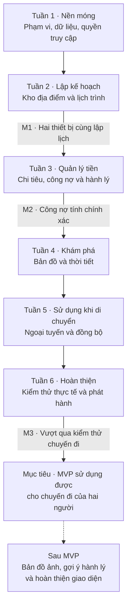

# HaGiangWiki — Quy trình thực hiện dự án

> Kế hoạch xây dựng ứng dụng lập lịch trình, bản đồ và quản lý chi tiêu du lịch dành cho hai người.

- **Ngày cập nhật:** 09/11/2026.
- **Thư mục dự án:** `D:\Dev\HaGiangWiki`.
- **Trạng thái:** đã tạo thư mục dự án; chưa triển khai mã nguồn.
- **Khung thời gian tham khảo:** 6 tuần cho 1 lập trình viên làm toàn thời gian.
- **Cách sử dụng:** thực hiện theo thứ tự phụ thuộc; chỉ đánh dấu hoàn thành khi đạt tiêu chí nghiệm thu, không chỉ khi đã viết xong giao diện.

## 1. Mục tiêu của bản MVP

Hai người có thể cùng chuẩn bị và sử dụng một chuyến đi qua luồng:

**Tạo chuyến đi → Gom địa điểm → Xếp lịch → Xem bản đồ → Ghi chi tiêu → Quyết toán.**

### Trong phạm vi

- Tạo và cấu hình chuyến đi; cấp và thu hồi quyền truy cập cho người đồng hành.
- Kho địa điểm chưa xếp lịch, lịch trình theo ngày và thứ tự điểm dừng.
- Giao diện ưu tiên điện thoại, có chuyển đổi giữa bản đồ và danh sách.
- Một kiểu bản đồ địa lý, thời tiết cơ bản và ước tính quãng đường/thời gian di chuyển.
- Thêm, sửa, xóa khoản chi; ba kiểu chia tiền; số dư công nợ và ghi nhận chuyển trả.
- Checklist hành lý chung và cá nhân ở mức cơ bản.
- Xem lịch trình đã tải khi mất mạng; thêm khoản chi vào hàng đợi để đồng bộ khi có mạng.
- Trạng thái lưu dữ liệu rõ ràng; xuất hoặc sao lưu dữ liệu chuyến đi.

### Sau MVP

- Bản đồ ảnh tùy chỉnh và cơ chế hiệu chỉnh tọa độ trên ảnh.
- Tự động gợi ý hành lý theo số ngày và phương tiện.
- Trình bày thời tiết nâng cao cho nhiều khu vực.
- Hiệu ứng, hình ảnh và bố cục Editorial hoàn chỉnh.
- Nhóm nhiều hơn hai người, nhiều loại tiền và các tỷ lệ chia tiền khác.

## 2. Nguyên tắc thực hiện

1. Hoàn thiện từng luồng từ giao diện đến cơ sở dữ liệu, tránh để phần lưu trữ đến cuối dự án.
2. Có môi trường triển khai thử từ tuần 1 và kiểm tra trên hai điện thoại từ tuần 2.
3. Thiết kế quyền truy cập, version dữ liệu và chống gửi trùng ngay từ nền móng.
4. Kiểm thử logic tiền và các thao tác có thể gây mất dữ liệu trong từng giai đoạn.
5. Khi mất mạng hoặc dịch vụ bên ngoài lỗi, việc xem lịch đã lưu và ghi chi tiêu vẫn có phương án xử lý.
6. Chi phí 0 đồng là mục tiêu trong giới hạn sử dụng; kiểm tra điều kiện dịch vụ trước khi chọn nhà cung cấp.
7. Lịch 6 tuần là ước tính, không phải cam kết thời hạn; điều chỉnh theo kết quả nghiệm thu và thời gian thực tế.

## 3. Các quyết định cần chốt trong tuần 1

| Nội dung | Kết quả cần xác định |
| --- | --- |
| Truy cập chuyến đi | Cách mời người đồng hành, xác thực yêu cầu sửa dữ liệu và thu hồi quyền. Không dùng riêng ID chuyến đi làm bằng chứng cấp quyền. |
| Ngày và giờ | Ngày khởi hành, múi giờ chuyến đi và cách lưu giờ đến/rời địa điểm. |
| Ngân sách | Tính cho cả hai hay từng người; có bao gồm khoản cá nhân không; có cộng dự toán địa điểm trong kho tạm không. |
| Tiền lẻ | Đơn vị tiền, cách chia số lẻ và làm tròn; dùng cùng quy tắc ở backend, giao diện và kiểm thử. |
| Chuyển trả | Ghi nhận thanh toán công nợ riêng với chi tiêu, cách sửa/hủy và cách tính số còn nợ. |
| Thay đổi số ngày | Cách xử lý điểm dừng thuộc những ngày bị bỏ, tránh làm mất dữ liệu âm thầm. |
| Địa điểm thiếu GPS | Cho phép lưu địa điểm chưa có tọa độ; không gọi định tuyến/thời tiết bằng tọa độ giả định. |
| Ngoại tuyến | MVP hỗ trợ đọc lịch đã tải và thêm khoản chi; sửa lịch trình cần kết nối mạng. |
| Dịch vụ và phiên bản | Chốt phiên bản công nghệ, nhà cung cấp, giới hạn miễn phí và cấu hình triển khai. |

## 4. Roadmap tổng thể

## 5. Công việc và nghiệm thu từng giai đoạn

### Tuần 1 — Chốt phạm vi và dựng nền móng

**Công việc**

- [ ] Chốt các quyết định nghiệp vụ tại mục 3 và phác thảo các màn hình điện thoại chính.
- [ ] Chốt phiên bản công nghệ; định hướng ban đầu là React + Vite + Tailwind, Node.js + Express, Prisma + PostgreSQL.
- [ ] Tạo cấu trúc frontend/backend, cấu hình môi trường mẫu và hướng dẫn chạy cục bộ.
- [ ] Hoàn thiện các mô hình Trip, Stop, Expense, PackingItem; thiết kế thêm dữ liệu quyền truy cập và thanh toán công nợ.
- [ ] Bổ sung ngày khởi hành, quy tắc validation, chỉ mục và ràng buộc quan hệ cần thiết.
- [ ] Bảo đảm khoản chi và điểm dừng được liên kết thuộc cùng một chuyến đi.
- [ ] Thiết kế ID do client tạo, khóa chống gửi trùng và kiểm tra version cho thao tác ghi.
- [ ] Xây dựng luồng tạo/mở chuyến đi, mời người đồng hành và thu hồi quyền.
- [ ] Triển khai môi trường thử với dữ liệu mẫu Hà Giang.

**Nghiệm thu:** mở được bản triển khai thử trên điện thoại; tạo và tải lại được chuyến đi; yêu cầu sửa từ người không có quyền bị từ chối. Không đưa thông tin bí mật vào mã nguồn hoặc tài liệu công khai.

### Tuần 2 — Kho địa điểm và lịch trình dùng chung

**Công việc**

- [ ] Thêm, sửa, xóa địa điểm; lưu kho tạm với `day = 0`.
- [ ] Chuyển địa điểm vào ngày, chuyển giữa các ngày và đổi thứ tự trong ngày.
- [ ] Cập nhật thứ tự theo transaction; xác định cách đánh số nhãn hiển thị.
- [ ] Hiển thị lịch trình, giờ, ghi chú, đặt chỗ và dự toán tại điểm dừng.
- [ ] Cập nhật cấu hình chuyến đi và xử lý giảm số ngày theo quy tắc đã chốt.
- [ ] Bổ sung trạng thái tải, dữ liệu trống, lỗi lưu và dữ liệu đã thay đổi trên thiết bị khác.
- [ ] Làm mới dữ liệu trên hai thiết bị; phát hiện cập nhật dựa trên version cũ.

**Mốc M1:** hai thiết bị cùng thêm/sửa/xếp điểm dừng; tải lại vẫn đúng dữ liệu; thay đổi thứ tự không làm mất hoặc trùng điểm; quyền truy cập được áp dụng cho mọi thao tác.

### Tuần 3 — Chi tiêu, công nợ và checklist

**Công việc**

- [ ] Thêm, sửa, xóa chi tiêu, có thể gắn với điểm dừng hoặc chỉ gắn với chuyến đi.
- [ ] Hỗ trợ người trả A/B và ba kiểu `EQUAL`, `FOR_OTHER`, `PERSONAL`.
- [ ] Hiển thị dự toán, thực chi và chênh lệch theo quy tắc ngân sách đã thống nhất.
- [ ] Tính công nợ, xử lý tiền lẻ và trạng thái không còn nợ.
- [ ] Ghi nhận chuyển trả bằng dữ liệu thanh toán riêng; tính số dư còn lại.
- [ ] Áp dụng chống gửi trùng ngay từ API ghi chi tiêu và chuyển trả.
- [ ] Làm checklist cơ bản: đồ chung có người phụ trách, đồ cá nhân có trạng thái cho A/B.
- [ ] Kiểm thử phép tính công nợ, sửa/xóa giao dịch và thao tác gửi lại yêu cầu.

**Mốc M2:** các tình huống chia tiền cho kết quả đúng; sửa/xóa cập nhật đúng số dư; chuyển trả giảm đúng số còn nợ; gửi lại cùng giao dịch không tạo bản sao.

**Ví dụ đối chiếu:** A trả 600.000đ chia đôi, B trả 200.000đ chia đôi, A trả hộ B 100.000đ ⇒ B nợ A 300.000đ. Nếu B đã chuyển trả A 100.000đ thì số còn nợ là 200.000đ. Khoản cá nhân không làm thay đổi công nợ giữa hai người.

### Tuần 4 — Bản đồ địa lý và thời tiết cơ bản

**Công việc**

- [ ] Làm một bản đồ địa lý với ghim điểm dừng, lọc theo ngày và chọn điểm trên danh sách/bản đồ.
- [ ] Tạo chuyển đổi Bản đồ/Danh sách phù hợp điện thoại.
- [ ] Nhập hoặc chọn GPS thực; hiển thị rõ địa điểm chưa có tọa độ.
- [ ] Tích hợp ước tính quãng đường/thời gian giữa các điểm, theo cấu hình phương tiện phù hợp.
- [ ] Tích hợp thời tiết hiện tại hoặc dự báo ngày đến khi nguồn dữ liệu hỗ trợ.
- [ ] Hiển thị nguồn, thời điểm dữ liệu và trạng thái không có dự báo cho ngày được chọn.
- [ ] Thêm cache có thời hạn, timeout, giới hạn gọi lại và phương án khi API lỗi.

**Nghiệm thu:** ghim khớp địa điểm; không dùng tọa độ giả cho điểm còn thiếu GPS; phân biệt dữ liệu thời tiết hiện tại với dự báo; lỗi dịch vụ ngoài không chặn lập lịch và ghi tiền.

### Tuần 5 — Ngoại tuyến và đồng bộ an toàn

**Công việc**

- [ ] Lưu lịch trình đã tải để đọc khi mất mạng, kèm thời điểm cập nhật gần nhất.
- [ ] Lưu bền vững khoản chi chờ gửi để không mất khi tải lại hoặc đóng/mở ứng dụng.
- [ ] Đồng bộ hàng đợi khi có mạng, sử dụng cùng ID/khóa chống trùng khi gửi lại.
- [ ] Hiển thị rõ Đang lưu, Đã lưu và Chưa đồng bộ.
- [ ] Xử lý trường hợp server đã lưu nhưng client chưa nhận được phản hồi.
- [ ] Xử lý xung đột version và trường hợp quyền truy cập bị thu hồi trong lúc ngoại tuyến.
- [ ] Kiểm thử mất mạng, kết nối chập chờn, tải lại và thao tác đồng thời trên hai thiết bị.

**Nghiệm thu:** mất mạng vẫn đọc được lịch đã tải và thêm khoản chi chờ gửi; mở lại ứng dụng không mất hàng đợi; có mạng lại thì mỗi khoản được ghi đúng một lần. Không báo Đã lưu khi server chưa xác nhận và không ghi đè xung đột âm thầm.

### Tuần 6 — Kiểm thử thực tế và phát hành MVP

**Công việc**

- [ ] Chạy trọn luồng chuyến đi giả lập theo danh sách tại mục 7 trên hai điện thoại.
- [ ] Kiểm tra giao diện trên điện thoại/máy tính, thao tác chạm, thông báo lỗi và thời gian tải.
- [ ] Kiểm tra lại quyền truy cập, dữ liệu giữa các chuyến và tính chính xác của công nợ.
- [ ] Bổ sung xuất/sao lưu dữ liệu và thử quy trình khôi phục hoặc nhập lại phù hợp định dạng đã chọn.
- [ ] Hoàn thiện README chạy dự án, cấu hình môi trường mẫu và hướng dẫn sử dụng.
- [ ] Kiểm tra giới hạn và hành vi của các dịch vụ đã chọn trước khi phát hành.
- [ ] Triển khai bản phát hành, kiểm tra sau triển khai và ghi lại cách quay về phiên bản trước.

**Mốc M3:** hoàn thành chuyến đi giả lập từ tạo lịch đến quyết toán, bao gồm mất mạng và lỗi dịch vụ ngoài. Không còn lỗi nghiêm trọng về truy cập trái phép, mất dữ liệu, ghi trùng hoặc tính sai tiền.

## 6. Quy trình cho mỗi hạng mục

1. **Xác định kết quả:** ghi hành vi mong muốn, dữ liệu đầu vào, trường hợp lỗi và tiêu chí nghiệm thu.
2. **Kiểm tra phụ thuộc:** xác định thay đổi schema, API, quyền truy cập và ảnh hưởng đến dữ liệu cũ.
3. **Triển khai:** hoàn thiện từ lưu trữ/API đến giao diện và trạng thái lưu dữ liệu.
4. **Xác minh:** kiểm tra luồng chính và trường hợp biên; tự động hóa các kiểm thử nghiệp vụ hoặc rủi ro dữ liệu quan trọng.
5. **Thử trên môi trường triển khai:** kiểm tra bằng dữ liệu mẫu; dùng hai thiết bị khi có chức năng dùng chung.
6. **Ghi nhận:** cập nhật tiến độ, lỗi còn tồn tại và quyết định thay đổi phạm vi.

Một hạng mục chỉ hoàn thành khi dữ liệu được lưu đúng, quyền truy cập được kiểm tra, lỗi liên quan được xử lý và tiêu chí nghiệm thu đã đạt. Việc đánh dấu hoàn thành phải dựa trên kết quả kiểm tra thực tế.

## 7. Kịch bản nghiệm thu xuyên suốt

- [ ] A tạo chuyến đi 3 ngày, cấp quyền cho B; B mở được trên thiết bị khác.
- [ ] A thêm địa điểm vào kho tạm, B xếp vào ngày 1; cả hai tải lại vẫn thấy đúng lịch.
- [ ] Hai người cập nhật cùng một dữ liệu; ứng dụng phát hiện và xử lý xung đột theo quy tắc đã chốt.
- [ ] Đổi thứ tự điểm dừng và giảm số ngày không làm mất dữ liệu âm thầm.
- [ ] Thêm khoản chi với đủ ba kiểu chia, sửa/xóa khoản chi và kiểm tra số dư.
- [ ] Kiểm tra tình huống tiền lẻ, số dư bằng 0 và ghi nhận chuyển trả một phần/toàn bộ.
- [ ] Kiểm tra khoản chi không thể gắn điểm dừng thuộc chuyến khác.
- [ ] Ngắt mạng, đọc lịch đã tải, thêm khoản chi rồi đóng/mở lại ứng dụng.
- [ ] Kết nối lại và gửi lại yêu cầu; mỗi khoản chi chỉ xuất hiện một lần.
- [ ] Dịch vụ thời tiết/định tuyến lỗi; người dùng vẫn lập lịch và ghi tiền được.
- [ ] Thu hồi quyền của B; các yêu cầu ghi tiếp theo từ B bị từ chối.
- [ ] Xuất/sao lưu dữ liệu và xác minh dữ liệu có thể đọc, khôi phục hoặc nhập lại theo thiết kế.

## 8. Theo dõi tiến độ và điều chỉnh phạm vi

| Hạng mục | Trạng thái hiện tại | Bằng chứng để cập nhật |
| --- | --- | --- |
| Thư mục dự án | Đã tạo | Có thư mục `HaGiangWiki`. |
| Tài liệu tổng quan dự án | Đã tạo | Có tệp `readme.md`. |
| Tài liệu quy trình | Đã tạo | Có tệp `QUY_TRINH_DU_AN.md`. |
| Tuần 1 | Chưa bắt đầu | Môi trường thử, mô hình dữ liệu và luồng truy cập đạt nghiệm thu. |
| Tuần 2 / M1 | Chưa bắt đầu | Kết quả thử lập lịch trên hai thiết bị. |
| Tuần 3 / M2 | Chưa bắt đầu | Kết quả kiểm thử công nợ và chống ghi trùng. |
| Tuần 4 | Chưa bắt đầu | Bản đồ/thời tiết hoạt động và có phương án khi lỗi. |
| Tuần 5 | Chưa bắt đầu | Kết quả thử ngoại tuyến, gửi lại và xung đột. |
| Tuần 6 / M3 | Chưa bắt đầu | Kết quả nghiệm thu trọn luồng và bản phát hành. |

Khi chậm tiến độ, giảm mức hoàn thiện hình thức, lùi tính năng nâng cao và có thể lùi checklist nếu phần chi tiêu cần thêm thời gian. Giữ ưu tiên cho quyền truy cập, lưu dữ liệu, công nợ chính xác và sử dụng được trên hai điện thoại. Sau mỗi tuần, cập nhật trạng thái, bằng chứng nghiệm thu và thời gian dự kiến còn lại vào tài liệu này.
